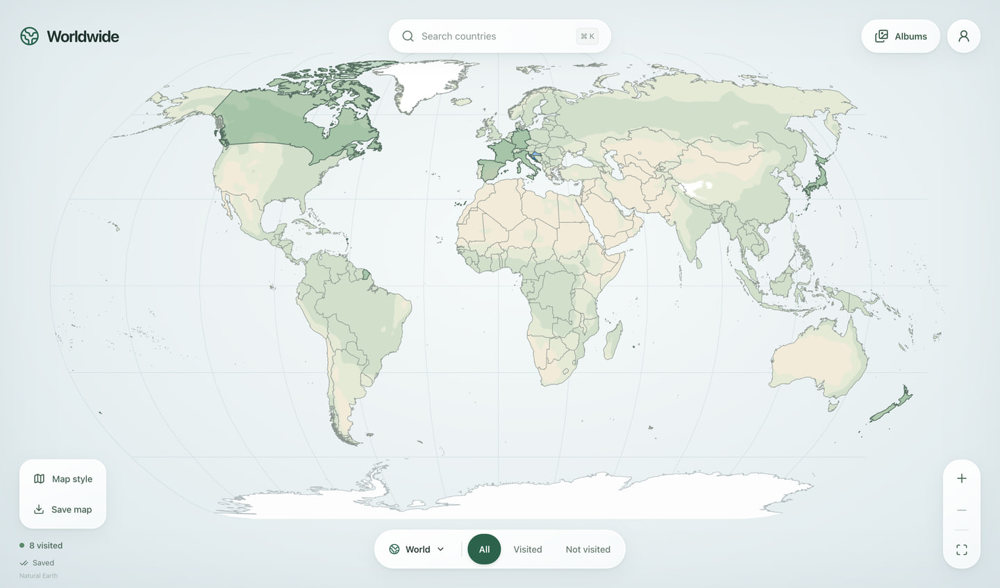
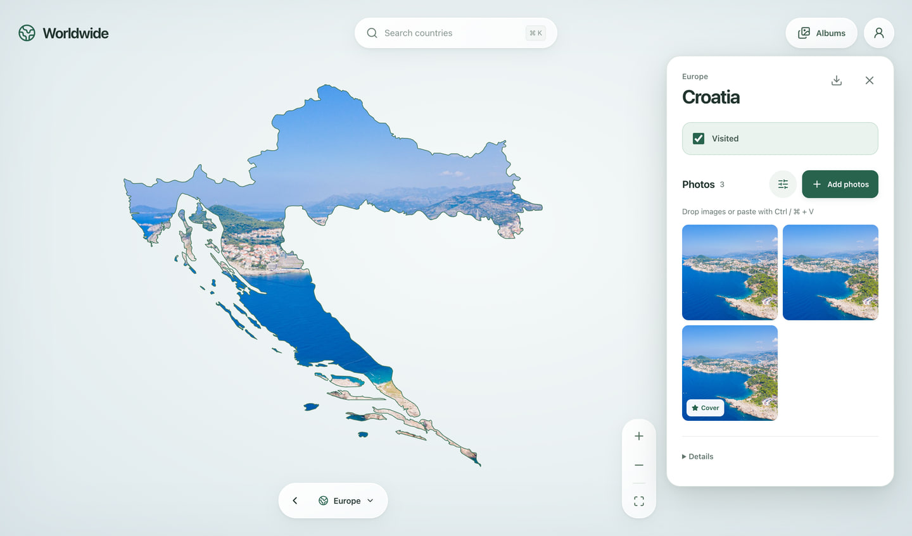
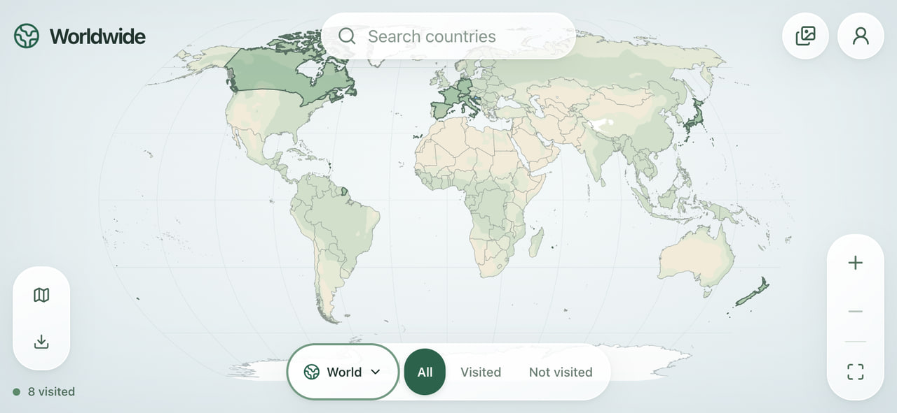
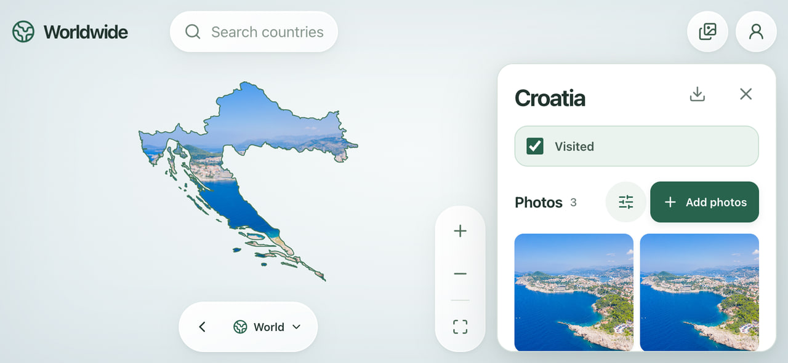

  

Your private travel photo map.

  
  &nbsp;
  

Android 8+ · Windows 10/11 Install updates over the existing app to keep your photos.

## A look at Worldwide

<table>
  <tr><th>Desktop · world map</th><th>Desktop · country album</th></tr>
  <tr>
    <td></td>
    <td></td>
  </tr>
  <tr><th>Phone · world map</th><th>Phone · country album</th></tr>
  <tr>
    <td></td>
    <td></td>
  </tr>
</table>

Sample album; phone layouts shown in a responsive browser. [Photo credit](docs/screenshots/README.md).

Use either app on its own. To sync them, open **Your album → Connect phone** on the computer and scan from the Android app. Use the same Wi-Fi. Photos and offline edits stay saved on each device.

[Local website setup](docs/local-website.md) · [Desktop setup](desktop/README.md) · [Android setup](mobile/android/README.md)

Map data: [Natural Earth](https://www.naturalearthdata.com/).
