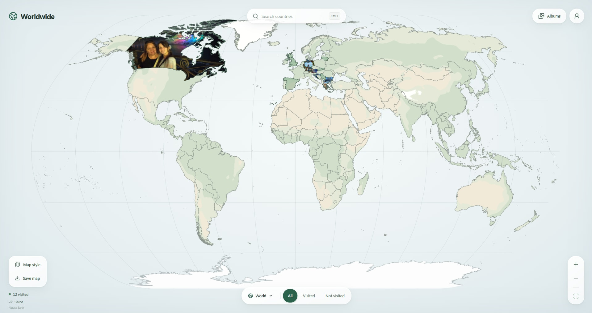
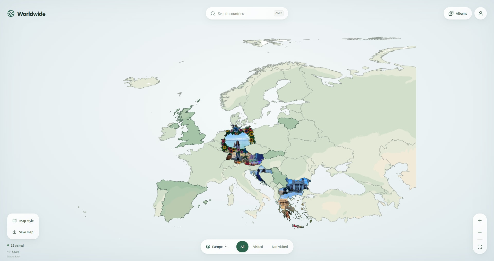
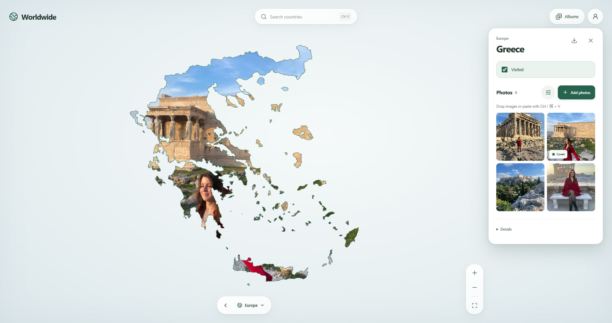

  

Worldwide is a private travel map where you can mark visited countries, fill their shapes with photos, and keep a photo gallery for each country. Use it offline on your PC or phone, with optional sync between devices.

  

  

Android 8+ · Windows 10/11 Install updates over the existing app to keep your photos.

## A look at Worldwide

  

<table>
  <tr><th>Europe</th><th>Country album</th></tr>
  <tr>
    <td></td>
    <td></td>
  </tr>
</table>

Use either app on its own. To sync them, open **Your album → Connect phone** on the computer and scan from the Android app. Use the same Wi-Fi. Photos and offline edits stay saved on each device.

[Local website setup](docs/local-website.md) · [Desktop setup](desktop/README.md) · [Android setup](mobile/android/README.md)

Map data: [Natural Earth](https://www.naturalearthdata.com/).
